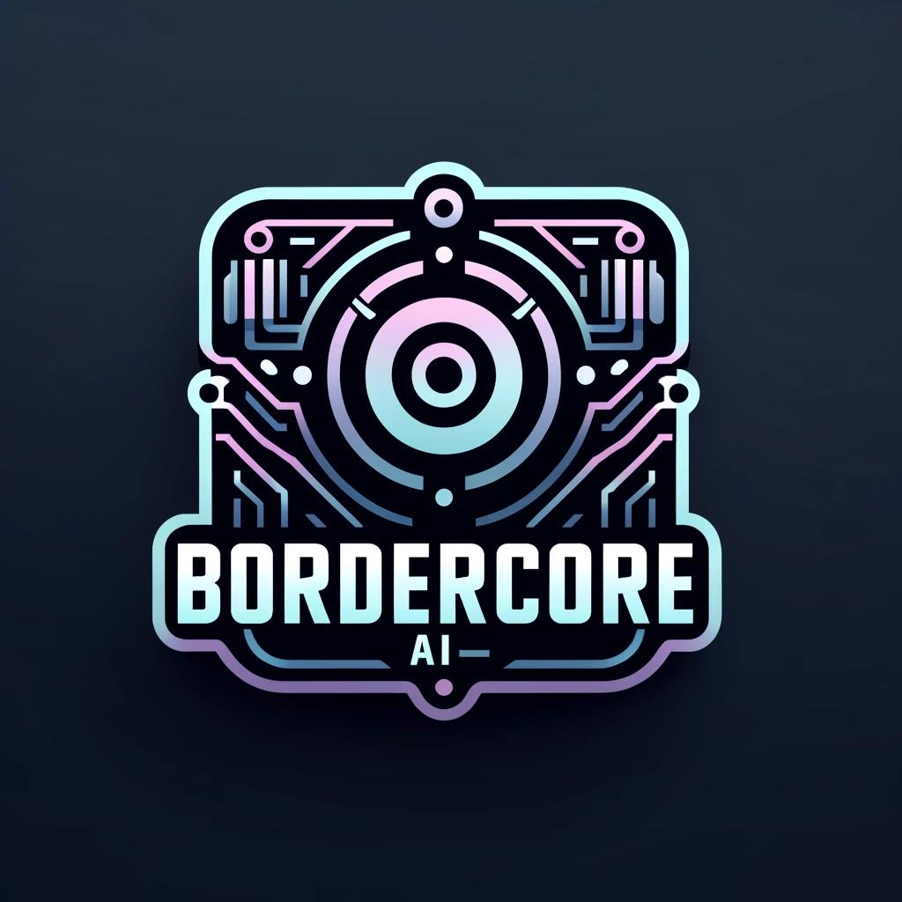
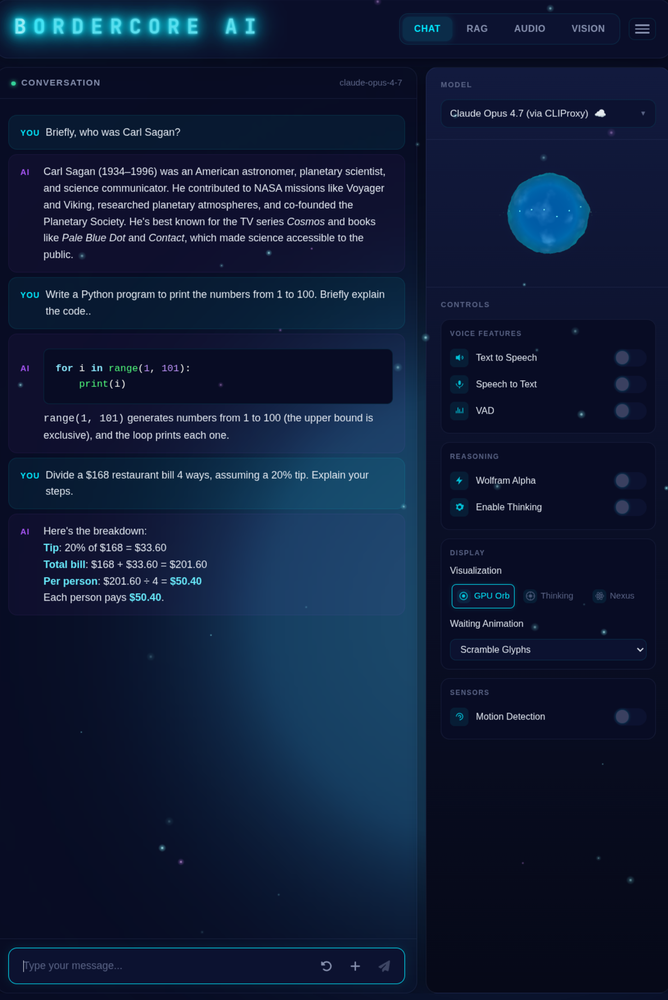

---

Bordercore AI is a web-based AI chatbot and voice assistant supporting multiple open-weight and commercial LLMs, Text to Speech (TTS), Speech to Text (STT), audio transcription and RAG (Retrieval Augmented Generation). Discord bots are also supported.



# Features

## Conversation branches

Create a separate conversation from any completed message or from the current
tip without changing the original thread. The conversation header provides a
quick branch switcher, while **Manage branches** opens the complete nested
conversation tree for navigation, renaming, and deletion. New chats are kept as
independent root conversations instead of replacing the current history.

Conversation messages and per-branch drafts are stored in browser IndexedDB,
so branches remain available after refreshing the page or restarting the
backend. This storage is local to the current browser profile and is not synced
between devices.

## Inference engines and providers

| Engine or provider | Use | Models and formats |
|--------------------|-----|--------------------|
| [vLLM](https://docs.vllm.ai/) | Primary local GPU inference server | Managed Hugging Face/Safetensors checkpoints, including quantized text and multimodal models |
| [llama.cpp](https://github.com/ggml-org/llama.cpp) | Managed GPU server or in-process fallback through `llama-cpp-python` | GGUF models, including Qwen3.6 and Qwen3.8 vision |
| [Transformers](https://huggingface.co/docs/transformers/) | In-process non-AWQ model loading and speech recognition | Hugging Face text, vision, and Whisper-compatible checkpoints |
| OpenAI-compatible APIs | Hosted or local API inference | OpenAI and compatible endpoints, including vLLM and API proxies |
| Anthropic API | Hosted Claude inference | Anthropic models |
| [OpenRouter](https://openrouter.ai/) | Hosted API inference with your own API key | Any OpenRouter chat model ID configured in `models.yaml` |

AWQ checkpoints are served exclusively through vLLM; the application no longer
loads them in-process with AutoAWQ. Managed profiles safely switch between the
vLLM and llama.cpp loopback APIs, with health checks and rollback. See
[`deploy/linux/systemd/README.md`](deploy/linux/systemd/README.md) for the
current profile inventory and deepvirtual service setup.

When a local model is active, the model picker includes an **Unload local
model** action. It stops managed inference services and releases in-process
weights so the GPU can be used by other workloads. The selected model remains
visible and can be selected again to reload it. Speech recognition has a
separate lifecycle: its resident Whisper pipeline follows the configured idle
timeout or can be released explicitly through the ASR API.

## Text to Speech (TTS)

Three TTS engines are supported: [Kokoro](https://kokorottsai.com/), [Chatterbox](https://github.com/resemble-ai/chatterbox), and [Qwen3-TTS](https://huggingface.co/Qwen/Qwen3-TTS-12Hz-0.6B-Base).

On NVIDIA hosts, Qwen3-TTS uses
[`faster-qwen3-tts`](https://github.com/andimarafioti/faster-qwen3-tts)
with the qwentts.cpp GGML backend. It streams codec frames while a sentence
is still being synthesized instead of waiting for the complete sentence.
Install its inference packages into the configured Qwen environment with:

```bash
scripts/install_faster_qwen3_tts.sh
```

The installer intentionally uses `--no-deps`: Bordercore's main environment
already supplies Qwen, PyTorch, Transformers, NumPy, SoundFile, and Hugging
Face Hub, while the upstream package currently declares dependency versions
that conflict with Bordercore's Python 3.12 environment.

Assistant responses are normalized on a copy before being sent to any TTS
engine; the Markdown displayed in chat is never changed. The ordered spoken-text
pipeline:

- omits fenced code, images, citations, configured do-not-speak content, and
  emoji;
- speaks link labels while replacing bare URLs with “link”;
- removes Markdown formatting and HTML tags while retaining readable text;
- applies configured pronunciation overrides; and
- collapses whitespace and skips sentences that become empty.

Exact normalized sentences are available in the browser's debug console as
`[TTS] normalized segment` entries. Configure pronunciation and omission rules
in `settings.py`:

While streaming TTS plays, the sentence currently being spoken is highlighted
in the corresponding assistant response. The browser maps normalized speech
back to the rendered Markdown without changing the stored message. The
highlight advances with playback and clears immediately when speech completes,
is paused, is interrupted, fails, or is replaced by another response.

```python
tts_pronunciations = {
    "BordercoreAI": "Bordercore A I",
    "GPU": "G P U",
}

# Trusted JavaScript regular expressions applied to spoken text only.
tts_do_not_speak_patterns = [
    r"\[internal\][\s\S]*?\[/internal\]",
]
```

Responses can also mark explicit omissions with
`<nospeak>...</nospeak>`, `<tts-ignore>...</tts-ignore>`, or paired
`<!-- tts-ignore-start -->` and `<!-- tts-ignore-end -->` comments.

### TTS capability discovery

Each maintained TTS service exposes `GET /capabilities` with a versioned
contract describing its engine, readiness, streaming audio format, sample
rate, voices, default voice, speed support, and voice-cloning support:

```json
{
  "api_version": 1,
  "engine": "kokoro",
  "status": "ready",
  "streaming": true,
  "audio_format": "wav_pcm_s16le",
  "sample_rate": 24000,
  "voices": ["af_heart", "bf_emma"],
  "default_voice": "bf_emma",
  "supports_speed": true,
  "supports_cloning": false
}
```

The browser queries this endpoint whenever the selected TTS host changes,
caches successful responses for 30 seconds, and provides a manual refresh
control in Preferences. The Voice menu is populated from the selected server,
so profiles from one engine are not sent to another. Readiness is shown as
loading, ready, degraded, or failed.

Older and custom TTS servers remain compatible. A missing or incompatible
capability endpoint produces a degraded state and falls back to the voice list
provided by the main web application. Network and server failures are shown
without discarding that fallback list.

## Speech to Text (STT)

Speech recognition uses Hugging Face Transformers with
[Distil-Whisper](https://huggingface.co/distil-whisper/distil-large-v3), based
on OpenAI's [Whisper](https://github.com/openai/whisper). The model loads on
the first recording and stays resident so subsequent transcriptions start
quickly. By default, it unloads after 15 minutes without a transcription to
release its GPU memory. The timeout can be changed in Preferences, including
an option to keep the model loaded with no timeout.

For manual recording, turn **Speech to Text** on, speak, and turn it off to
stop recording and submit the audio for transcription. When VAD is enabled,
voice activity detection can stop the recording automatically. VAD also
supports voice barge-in: speaking while an answer is being generated or read
aloud stops the active TTS playback and requests, aborts generation, and marks
the partial assistant response as interrupted. The next request is told that
the interrupted response may not have been fully heard. Browser VAD uses the
Silero V5 model through pinned `vad-web` and ONNX Runtime versions so runtime
updates do not silently change turn detection. Speech must reach Silero's
minimum confirmed duration before triggering barge-in, so rejected clicks,
coughs, and other VAD misfires do not interrupt the assistant.

VAD can start speech recognition speculatively during the end-of-turn silence
window. The browser builds a provisional WAV directly from the 16 kHz frames
already produced by `vad-web`, then reuses its transcript when Silero confirms
the endpoint. If speech resumes, the provisional request is invalidated and a
new one can start at the next likely endpoint; tentative transcripts never
become chat messages. This overlaps ASR with the default 900 ms silence window
without adding another model or consuming additional persistent VRAM.

### Voice latency diagnostics

The controls sidebar shows timing for the latest manual or VAD voice turn:

- **ASR** runs from detected speech end to the completed transcription.
- **ASR head start** shows how much recognition ran before the endpoint was
  confirmed; a positive value means speculative transcription was attempted.
- **First token** runs from the LLM request to the first streamed response
  chunk.
- **First sentence** runs from the first token to the first segment ready for
  TTS.
- **First audio** runs from speech end to the first scheduled audible buffer.
- **Total turn** runs from detected speech start to completion, interruption,
  cancellation, or failure.
- **TTS RTF** is synthesis time divided by generated audio duration. Values
  below `1.0×` mean synthesis is faster than real time.
- **Queue / buffer** reports peak sentence queue depth and scheduled audio.
- **VAD confidence / speech frames** reports average and peak Silero speech
  probability plus the proportion of analyzed frames above the configured
  speech threshold. Short detections rejected by VAD are counted as misfires.
- **VAD confirmation** measures tentative speech start to confirmed speech.
- **VAD endpoint** measures the delay from the last speech-positive frame to
  the committed end of the user turn. The default silence window is 900 ms.

Each turn has a stable ID across ASR, LLM streaming, and TTS. Completed,
interrupted, cancelled, failed, and VAD-misfire turns are counted separately.
A structured summary is written to the browser console and the server log as
`voice_turn_metrics`, providing a future integration point for
Prometheus/OpenTelemetry. These summaries contain timings and counters only;
audio, transcripts, prompts, and model responses are not included.

Before a transcription becomes a chat request, the browser rejects empty,
punctuation-only, explicitly labeled non-speech, and narrowly matched Whisper
subtitle boilerplate. Legitimate short replies such as “Yes,” “No,” and
“Stop” remain valid. Rejected transcripts are counted as discarded turns and
prompt the user to try again without another model call.

## RAG (Retrieval Augmented Generation)

Chat with your uploaded documents.

## Audio Transcription

Upload audio files to convert them to text, then ask questions based on the generated transcription. YouTube URLs are also supported.

## Multimodality

Support for the **Qwen3-VL** and unified Qwen vision models for analyzing
images. Upload images, drag-and-drop them into the UI, or paste an image from
the clipboard while Vision mode is active.

## Tool Calling

Built-in tools include Wolfram Alpha (math), weather lookup, Govee smart-light control, music playback, and Google Calendar. Additional tools can be exposed via [Model Context Protocol (MCP)](https://modelcontextprotocol.io/) servers — see `MCP_SERVERS` in `settings_template.py`.

## Hermes Agent memory

Bordercore can optionally use
[Hermes Agent](https://github.com/NousResearch/hermes-agent) as a long-term
memory sidecar. Hermes recalls relevant memories before inference and reviews
completed exchanges for durable facts afterward. The model selected in the UI
continues to generate every visible response through Bordercore's normal model
and tool dispatcher.

Enable the Hermes API server separately, keep it on a trusted loopback or
private interface, and configure Bordercore:

```python
hermes_enabled = True
hermes_base_url = "http://127.0.0.1:8642/v1"
hermes_api_key = "replace-with-the-Hermes-API_SERVER_KEY"
hermes_model = "hermes-agent"
```

The same values can be supplied as `HERMES_ENABLED`, `HERMES_BASE_URL`,
`HERMES_API_KEY`, and `HERMES_MODEL` environment variables. Set
`HERMES_MEMORY_TIMEOUT_SECONDS` to bound each recall or storage operation; it
defaults to 30 seconds. Environment variables take precedence, allowing
production deployments to keep the API key in an owner-only service
environment file instead of `settings.py`.

When configured, **Agent Memory** appears in the Controls panel. Enabling it
does not change the selected model. Bordercore assigns an opaque, stable memory
scope to the browser's server-side session and passes it using Hermes's
`X-Hermes-Session-Key` header. Recall and storage failures are non-fatal: the
selected model continues without memory. The Hermes API key is never sent to
the browser.

Hermes controls which memory provider and tools are active. Because its API
may expose terminal, filesystem, browser, and other consequential tools, limit
and configure those capabilities in Hermes before enabling Agent Memory.

## Thinking

Supports some so-called "thinking" models, such as Qwen3.

## Chat with Web Pages

Paste a URL into the input box and say "Summarize" or something similar.

## Discord Bot Support

Discord bots can be backed by either OpenAI's ChatGPT or an open source LLM.

Set your server's channel ID in `settings.discord_channel_id`.

Set the environment variable `DISCORD_TOKEN`.

To run the local LLM bot:

```bash
python3 -m modules.chatbot -m localllm
```

To run the ChatGPT bot:

```bash
python3 -m modules.chatbot -m chatgpt
```

## Sensor Support

Experimental support for reading real-time sensor data. This can be used, for example, to activate Speech to Text by waving a hand in front of a sensor like the HLK-LD2410B.

To run the sensor webapp:

```bash
python3 -m sensor
```

# Installation

Bordercore AI requires:

- Python 3.12 (the project currently supports `>=3.12,<3.13`)
- Node.js and npm for the React frontend (CI uses Node.js 22)
- The `ffmpeg` executable for decoding uploaded and recorded audio
- PortAudio development libraries for microphone/audio support
- An NVIDIA GPU with a compatible CUDA environment for local GPU inference;
  hosted APIs and some Transformers workloads can run without one, and speech
  recognition can be configured to use the CPU

For example, install the native audio dependencies on Ubuntu:

```bash
sudo apt install ffmpeg portaudio19-dev
```

Python dependencies are managed with
[uv](https://github.com/astral-sh/uv). From the project root:

```bash
uv sync
```

Alternatively, create and activate a Python 3.12 virtual environment, then
install the dependencies from the project metadata:

```bash
pip install .
```

The application modules are run from the repository rather than installed as
a conventional Python package. Install and build the frontend package:

```bash
cd webapp
npm ci
npm run vite:build
cd ..
```

Copy `settings_template.py` to `settings.py` and set the following:

- **model_name**: default model to load.
- **model_dir**: absolute or relative path containing local model checkpoints.
- **asr_model**: Hugging Face speech-recognition model identifier.
- **asr_device**: speech-recognition device (`auto`, `cpu`, `cuda`, or a
  specific device such as `cuda:0`).
- **asr_idle_timeout_minutes**: number of idle minutes before the resident
  speech-recognition pipeline unloads; use `None` for no timeout.

Edit `models.yaml` to add configuration options for your models. Use `models_template.yaml` as a guide. Example:

```yaml
Qwen3-8B-AWQ-vLLM:
  name: Qwen3 8B AWQ
  type: api
  vendor: openai
  base_url: http://127.0.0.1:8001/v1
  api_key: not-needed
  thinking: true
  vllm_profile: Qwen3-8B-AWQ

example-model.gguf:
  name: Example GGUF model
  template: chatml
```

- **name** is the human-friendly label used in the UI.
- **provider** identifies the model maker (for example, `OpenAI`, `Anthropic`,
  or `Google`) and groups models under that heading in the picker. Keep the
  YAML flat, with model IDs as top-level keys, and arrange entries in provider
  sections. The picker follows their order, including model order within each
  section; models without a provider appear under **Other** at the end.
  The supplied order ranks models approximately strongest first within each
  provider for general-purpose work, rather than speed or cost. Reorder YAML
  entries to adjust this preference; OpenRouter Auto stays at the end because
  it routes requests instead of identifying a fixed model.
- **served_by** optionally names the serving service, such as `CLIProxy`, for
  a badge beside the model name. Otherwise the picker uses managed runtime
  profiles or the API vendor to show `vLLM`, `llama.cpp`, `OpenRouter`, `API`,
  or `Local`. This display metadata does not change request routing.
- **template** selects the fallback local-model chat template, such as `chatml`
  or `llama2`; a tokenizer's built-in template takes precedence.
- **type: api** identifies an API-backed model instead of an in-process local
  checkpoint.
- **vendor** selects the API client: `openai` for OpenAI-compatible endpoints,
  `openrouter` for OpenRouter, or `anthropic` for Anthropic.
- **base_url** and **api_key** override the configured OpenAI-compatible endpoint
  and credentials for that model.
- **vllm_profile** connects a model entry to an allow-listed managed vLLM
  profile.
- **llama_cpp_profile** connects a GGUF API entry to an allow-listed managed
  llama.cpp profile.
- **quantize: true** requests 4-bit bitsandbytes quantization for a compatible
  non-AWQ Transformers model; bitsandbytes must be installed separately.
- **qwen_vision: true** enables the Vision UI, including image input for
  OpenAI-compatible and OpenRouter models that support it.
- **thinking_control: chat_template_kwargs** sends the UI thinking toggle as a
  structured chat-template option. Qwen3.5 requires this instead of the legacy
  `/no_think` text command.
- **do_sample: false** disables sampling via `temperature`, `top_p`, and `top_k`.
- **add_bos_token: true** prepends a beginning-of-sequence token.

The template includes GPT-6.1 Sol, GPT-6.1 Terra, GPT-6 Luna, and GPT-6 Astra
through CLIProxy. Copy the desired entries into the Git-ignored `models.yaml`
and adjust `base_url` to your proxy host. For direct OpenAI API access, omit
`base_url`, `api_key`, and `served_by`, and set `openai_api_key` in `settings.py`.
Restart the backend after editing model configuration, then
refresh the model picker.

The template also includes [Gemini 4 Carbon, Neon, and Hydrogen](https://ai.google.dev/gemini-api/docs/models)
through CLIProxy, ordered strongest first. These use the model IDs
`gemini-4-carbon`, `gemini-4-neon`, and `gemini-4-hydrogen`. Your proxy must
expose the chosen models in its `/v1/models` listing before you use them;
adding an entry here does not enable Gemini access in CLIProxy.

The picker searches model names, IDs, providers, and serving badges. Use the
arrow keys to navigate results, Enter or Space to select a focused model, and
Escape to close. Provider headings remain visible while scrolling; the local
model unload action stays available while searching.

For these GPT models, select **Model default** temperature to omit the sampling
parameter when reasoning is enabled. The app's reasoning-effort selector
currently applies only to OpenRouter models.

To run:

```bash
python3 -m webapp
```

To access: https://localhost:5010/

## OpenRouter models

Set `openrouter_api_key` in the backend's `settings.py`, or supply
`OPENROUTER_API_KEY` in the backend process environment. The environment variable
takes precedence over the setting; a per-model `api_key` overrides both.
OpenRouter credentials are separate from `openai_api_key` and are never included
in the model metadata sent to the browser.

Add entries to `models.yaml` using exact IDs from the
[OpenRouter model catalog](https://openrouter.ai/models):

```yaml
openrouter/auto:
  name: OpenRouter Auto
  type: api
  vendor: openrouter

openai/gpt-4o:
  name: GPT-4o via OpenRouter
  type: api
  vendor: openrouter
  qwen_vision: true
```

Replace the YAML key with any OpenRouter chat model ID, including its provider
prefix and any variant suffix. There is no built-in model allowlist. Restart
the backend and refresh the page after changing model configuration; the
entries appear in the existing model picker. No local weights are loaded.

The client uses OpenRouter's
[OpenAI-compatible streaming API](https://openrouter.ai/docs/quickstart) at
`https://openrouter.ai/api/v1`. Set `qwen_vision: true` only for models that accept
image input. For models with optional reasoning, `thinking: true` exposes the
existing thinking toggle and forwards it as OpenRouter's `reasoning.enabled`.
Those models also get a **Thinking Effort** selector beside the toggle, which
forwards the chosen level as `reasoning.effort` while thinking is on; **Default**
leaves the level to the model. The selector offers `low`, `medium`, and `high`
unless the entry lists the levels its provider accepts, for example
`reasoning_efforts: [low, high, max]`. For a model that always reasons, set
`reasoning_efforts` without `thinking: true`: the selector then stays active
regardless of the toggle and no on/off flag is sent.
Models without that flag retain the provider's reasoning defaults. Chat displays
the answer text; separate reasoning fields are not displayed. Model availability
and supported capabilities depend on OpenRouter and the selected provider.

## Speech-recognition operations

The web application exposes lifecycle endpoints for the resident
speech-recognition pipeline:

| Method | Endpoint | Purpose |
|--------|----------|---------|
| `GET` | `/asr/status` | Report model state, device, timings, request count, and idle timeout |
| `POST` | `/asr/load` | Load the configured model before the next recording |
| `POST` | `/asr/unload` | Unload the model and release its GPU memory |
| `POST` | `/asr/config` | Change the idle timeout at runtime |

To change the timeout through the API, send a positive number of minutes or
`null` for no timeout:

```bash
curl --insecure -X POST https://localhost:5010/asr/config \
  -H 'Content-Type: application/json' \
  -d '{"idle_timeout_minutes": 15}'
```

`--insecure` is only needed when running with the application's local
self-signed development certificate.

## PostgreSQL MCP server (pg-mcp-server)

1. Configure `pg_mcp_server.toml` with your local Postgres connection string. Leave `allow_writes = false` to keep sessions read-only.
2. Make sure project dependencies are installed (see [Installation](#installation)).
3. Start the MCP server (defaults to HTTP transport on `127.0.0.1:8000/mcp`):
   ```bash
   python run_pg_mcp_server.py
   ```
4. Point the app to the MCP server by adding to `settings.py`:
   ```python
   MCP_SERVERS = {
       "postgres": {
           "url": "http://127.0.0.1:8000/mcp",
           "transport": "http",
       },
       # ...other servers...
   }
   ```

## Command line

You can interact with the API via the command-line:

```bash
python3 -m modules.chatbot -m interactive
```

Options:

- `--tts`: enable the configured TTS service.
- `--stt`: enable speech-to-text input.

To use RAG with a local file:

```bash
python3 -m modules.rag -f <filename>
```

# Usage

## UI

Type your text into the input box to send a message to the chatbot.

To the immediate right of the input box are two buttons. The first is **Regenerate Response**, which will re-send the last message to the chatbot, presumably in hopes that a different response will result. The second is **New Chat**, which will clear the chat history.

The **Selected Model** dropdown lets you choose which LLM the API uses to respond to your prompt.

### Options panel

Toggle features on and off:

- **Voice Features**: Text to Speech, Speech to Text, and VAD (Voice Activation Detection — auto-detects when you're done speaking to initiate a back-and-forth conversation).
- **Reasoning**: Wolfram Alpha tool calling and model thinking output.
- **Sensors**: Motion detection from a configured external sensor.

### Preferences menu

The hamburger menu to the upper-right organizes preferences into **General**,
**Appearance**, and **VAD** tabs. General includes:

- **Speech Recognition Idle Timeout**: Unloads Whisper after 5, 15, 30, or 60
  idle minutes, or keeps it resident with no timeout. The default is 15
  minutes.
- **Temperature**: Choose Model default, Precise (0.2), Balanced (0.7),
  Creative (1.0), or a custom value from 0 to 2. Model default omits the
  temperature parameter so the selected model or provider uses its native
  behavior. Models that use the `anthropic` vendor always run at their
  default, because current Claude models reject a temperature setting.
- **Audio Speed**: Playback speed of the TTS audio.
- **TTS Engine**: Select Kokoro, Chatterbox, or Qwen3-TTS and view its
  discovered identity and readiness. Managed engines sharing the deepvirtual
  endpoint are switched through an allow-listed backend action and verified
  before the selection becomes active.
- **Voice**: Select a built-in voice or cloning profile reported by the active
  TTS server.

Appearance includes:

- **Visualization**: Choose the primary thinking/audio visualization. Cyber
  Portrait shows a face that opens her eyes and looks around while a model is
  generating, and rests with her eyes closed otherwise. Nova and Sable are
  rigged 3D heads that act out each query; see
  [Nova and Sable](#nova-and-sable) below.
- **Nova Quality** / **Sable Quality**: Shown while Nova or Sable is
  selected; the two share one setting. Low drops the bloom pass and runs at
  24 fps; Medium (the default) and High add bloom and antialiasing at 30 and
  60 fps.
- **GPU Telemetry**: Choose the GPU activity visualization.
- **Waiting Animation**: Choose the animation shown while waiting for a
  response.
- **Cyberspace**: Toggle the animated flythrough between data-vault towers.
- **Panel Opacity**: Transparency of UI panels.
- **Starfield**: Toggle floating particle effects.
- **Cursor Effect**: Toggle animated streaks that follow the cursor (with density and speed sub-controls).

VAD includes bounded controls for speech-start and speech-end confidence,
end-of-turn silence, minimum accepted speech, pre-speech padding, and
speculative transcription. The speculation delay determines how long a likely
endpoint must remain quiet before ASR begins; it is always kept inside the
configured endpoint window. Changes are stored in the browser and
automatically restart an enabled VAD after a short debounce. Responsive,
Balanced, Patient Speaker, and Noisy Environment presets provide known
starting points; changing an individual control selects Custom automatically.
Each preset includes guidance about its best use case and responsiveness or
detection tradeoff. **Reset VAD defaults** restores the Balanced configuration.
The controls sidebar shows the active VAD state, preset, timings, confidence,
and the reason a segment was discarded. **Copy diagnostics** copies the
current configuration and latest turn data as JSON for troubleshooting. VAD
startup reports microphone permission, missing-device,
device-in-use, secure-connection, and model-loading failures, turns the VAD
switch back off, and includes the failure in copied diagnostics.

### Nova and Sable

Nova and Sable are neon portraits that come to life for each query: Nova in
dark blue, magenta and orange, Sable in deep blue with glowing eyes. Each is
a reference picture projected onto a rigged 3D head: the picture supplies the
look, and the head underneath lets her blink, speak, shift her gaze and turn
a few degrees. They are one component (`ProjectedFace`) showing different
faces, so they behave alike. Each follows the query:

- **Submit**: her eyes open, she looks at you, and the first glyph sparks on.
- **Waiting**: her gaze drifts away and neon glyphs grow denser the longer
  the wait: the marks painted on her face draw themselves in, a constellation
  joins up on one cheek, circuit traces grow from the temple along the jaw on
  the other, columns of hex and katakana appear, and a scan line sweeps down
  her face.
- **Streaming**: each chunk of text sends a pulse down the traces and lifts
  the glyphs' brightness. Reasoning that is hidden from the transcript counts
  as waiting.
- **Done**: the glyphs dissolve away, she returns to eye contact,
  then closes her eyes and stops drawing until the next query.

Rendering is kept light because it shares the machine with the model: the
pixel ratio is capped, bloom runs at half resolution, the glyph texture is
redrawn at a lower rate than the frame, and nothing is drawn while idle.

While one of them is on screen she can be driven from the browser console
through `window.nova` or `window.sable` (the same handle the component
exposes as a React ref):

```js
nova.setState("waiting");   // "idle" | "submit" | "waiting" | "streaming" | "done"
nova.setState(null);        // follow the chat again
nova.blink();               // blink(true) for a double blink
nova.lookAt(15, 5);         // yaw, pitch in degrees; lookAt(null) to release
nova.setSpeak(0.6);         // lip activity 0..1; null returns them to rest
nova.setGlyphIntensity(1);  // glyph density 0..1; null grows with time
```

Her mouth stays still unless driven with `setSpeak`. Two props on the
component control it:

- `mouthOpenness` sets how far her lips are parted at rest, from 1 (as in the
  picture) to 0 (closed). The default, 0.25, is mostly closed.
- `animateMouth`, off by default, makes her lips move by themselves: a slight
  parting and silent muttering while she waits, and movement in time with the
  text as it streams.

Each face is described by two files in `webapp/scripts/faces/`: its
reference picture (`nova.png`, `sable.jpg`) and a JSON file of marks made on
that picture by hand (`nova.json`, `sable.json`): 52 facial landmarks, the
two irises, and boxes around any glyphs painted on the skin. Two scripts in
`webapp/scripts/` turn those into the assets the component loads, taking the
face's name as their argument:

- `prepare_face_picture.py` splits the picture into the two layers in
  `webapp/static/img/` (`<face>.jpg`, `<face>-glyphs.jpg`): the picture with
  its painted glyphs and irises removed, and the glyphs on their own. It
  needs Pillow and NumPy.
- `bake-face.mjs` builds `webapp/static/models/<face>.glb` from
  [ICT-FaceKit](https://github.com/ICT-VGL/ICT-FaceKit) (MIT licence; the
  notice is alongside the models). It fits the kit's head to the marked
  landmarks, records where each vertex falls in the picture and how the eyes
  must be turned for the drawn irises to cover the marked ones, and keeps the
  kit's 53 expression shapes as morph targets under their ARKit names. It
  downloads about 210 MB of source meshes into a cache directory (the system
  temp directory by default; pass `--cache <dir>` to choose).

```bash
cd webapp
python scripts/prepare_face_picture.py sable
node scripts/bake-face.mjs sable
```

The marks are stored as fractions of the picture, so a higher-resolution
copy of the same picture can replace the reference and only the first script
needs to be run again.

To add another face, put its picture and marks in `webapp/scripts/faces/`,
run both scripts, and then register it: add an entry to `FACES` in
`webapp/front-end/react/utils/faceConfigs.ts` (iris colours, which cheek the
live constellation takes, and a few other settings that cannot be read off
the picture), and add its name to `VisualizationType` and `VISUALIZATIONS` in
`stores/ChatStoreContext.tsx` and to `VISUALIZATION_OPTIONS` in
`components/PreferencesMenu.tsx`.
[docs/projected-face-visualizations.md](docs/projected-face-visualizations.md)
is the full recipe: how to choose and mark a picture, check the fit, tune
the settings, and what to do when something looks wrong. Two helpers in
`webapp/scripts/` support the marking: `face_grid.py` enlarges part of the
picture under a pixel grid, and `face_fit_overlay.py` draws a fit over it.

# Tests

To run the unit tests:

```bash
uv run pytest
```

# Development

## Git hooks

The repository ships with shared Git hooks in `.githooks/`:

- **pre-commit**: flake8 F401 (unused Python imports), ESLint + Prettier on staged frontend files (via `lint-staged`), and mypy.
- **pre-push**: TypeScript typecheck (`tsc --noEmit`).

Enable them once per clone:

```bash
git config core.hooksPath .githooks
```

## Frontend linting / formatting

From `webapp/`:

```bash
npm run lint:react           # ESLint
npm run format:react         # Prettier --write
npm run format:check:react   # Prettier --check
npm run typecheck            # tsc --noEmit
npm run test:react           # Vitest
npm run stylelint            # stylelint
```

All frontend checks are blocking in CI: ESLint, Prettier, `typecheck`, Vitest,
`stylelint`, and the Vite build.

---

[](https://github.com/bordercore/bordercore-ai/actions/workflows/ci.yml)
